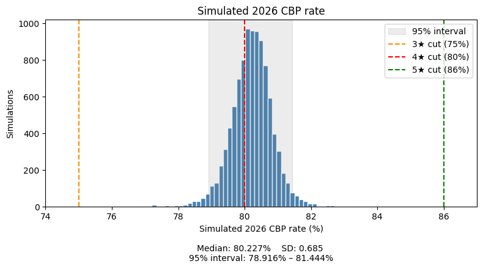
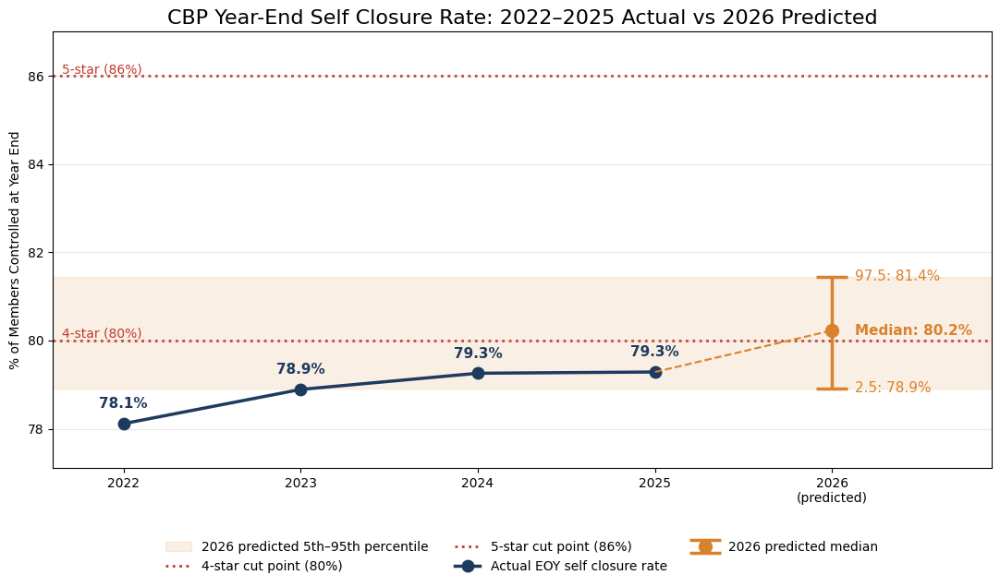
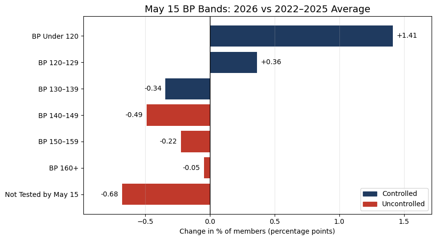

# Medicare Advantage Star Ratings Forecast

Forecasts year end closure rate for the measure controlling blood presure for hypertensive patients to quantify how much outreach is needed to reach or hold a target star rating.

## Contents
- About
- Summary
- Year End Forecast
- Comparison to Previous Years
- Model Reliability
- Limitations and Next Steps

  
## About

Medicare Advantage plans are scored on Star measures that affect reimbursement and enrollment. This project forecasts where the measure CBP will finish the year from a May 15th assessment point. The forecast estimates the measure's natural self-closure rate, the share of gaps expected to close without intervention, to determine where it will land relative to its current rating band and the next cut point. The goal is to inform an outreach team so they can determine if the measure is at risk and roughly how much outreach is needed to improve it. The project uses synthetic public health data generated with [Synthea](https://synthetichealth.github.io/synthea/). As a naive target it applies Star cut points drawn from the 2026 [CMS technical specifications](https://www.cms.gov/files/document/2026-star-ratings-technical-notes.pdf ) used to grade 2024 plans.

  
## Summary

As of May 15, the forecasted year end Controlling Blood Pressure rate was 80.22% (95% interval: 79.2-81.16%), 1.3 percentage points (184 patients) above the four-year average and .9 percentage points (129 patients) above the previous high in 2025. 33.69% of simulations result in a 3 star rating, 66.25% for 4 stars, and .02% for 5 stars. With respect to the lower bound percentile of simulations reaching 4 stars would take about 150 more controlled members, a 5.2% uplift and 979 more controlled members, a 33.6% uplift for 5 stars. With the 5-star cut point more than 8 standard deviations above the mean forcasted outcome, 5 stars is not a realistic target, and outreach should focus on securing 4 stars. The higher forecast is driven by our strongest May 15 start in four years, while the expected gain over the rest of the year is in line with  prior years. Identifying which members to target and the cost of closing them requires outreach data not yet in the database.

  
## Year End Forecast

  

The model simulated 10,000 year end outcomes for 2026 based on each member's status at May 15. The median simulated rate is 80.23%, and 95% of simulations fall between 78.92% and 81.44%.

**A 4 star rating is the most likely outcome, but the margin is thin.** The 4-star cut point sits almost exactly in the center of the distribution, which is why the outcome is close to a two way split: 66.25% of simulations finish at 4 stars and 33.69% at 3 stars. At the median, the measure clears 4 stars by about 0.2 percentage points, or roughly 31 members out of 13,805 leaving a thin cushion. At the lower end of the 95% interval, reaching 4 stars would take about 150 more controlled members, or 5.2% of the members still expected to be uncontrolled at year end. The 3-star floor at 75% is not a realistic concern. It is 7.6 standard deviations from the forecasted mean and only 4 of the 10,000 runs fell below it.

**Reaching 5 stars is not realistic without substantial outreach.** The 86% cut point is 8.4 standard deviations above the mean simulated rate. Only 2 of the 10,000 runs reached it, at 88.06% and 90.30%, which are 11.5 and 14.7 standard deviations above the mean. These runs are extreme outliers sittting, roughly 900 and 1,200 more year end controlled members than the optimistic 97.5 percentile. The 0.02% chance of 5 stars therefore more likely reflects tail outcomes rather than a plausible outcome. Closing the gap would take about 797 more controlled members at the median and 979 at the lower bound, 33.6% of the members expected to remain uncontrolled. Outreach success rates and cost per closure data would show whether pursuing it is feasible and cost effective.

  
## Comparison to Previous Years

  

**2026 is forecasted to be the first year above the 4 star cut point.** Year-end rates rose from 78.1% in 2022 to 79.3% in 2024, then held flat at 79.3% in 2025. The 2026 median forecast of 80.2% is 1.3 percentage points (184 members) above the four-year average of 78.9% and 0.9 percentage points (129 members) above the previous high in 2025. Even the lower bound of the 95% interval, 78.9%, matches the four-year average, so the forecast's worst plausible case is an average year rather than a decline.

  

**The higher forecast comes from a stronger start, not a faster finish.** 44.2% of members were controlled at May 15, the highest of any year: 0.6 percentage points above 2025 and 1.4 points above the four-year average of 42.8%. The gain from May 15 to year end has been stable, between 35.7 and 36.6 percentage points each year, and the forecast's expected gain of 36.0 points falls within that range. This also shows how thin the 4-star margin is. A gain at the low end of history, 35.7 points, would put 2026 at 79.9%, just below the cut point.

**The stronger start reflects broad improvement: more members tested and fewer uncontrolled.** The share not tested by May 15 fell from 46.7% in 2022 to 45.4% in 2026, and the share tested but uncontrolled fell every year, from 11.5% to 10.4%. Readings shifted toward lower blood pressure: the under-120 band grew from 23.6% to 25.9%, while the 140–149 and 150–159 bands each shrank by about half a point. The 160+ band is the exception, holding between 2.6% and 2.9% every year, so the most severely elevated members have not followed the broader improvement.

**Most of the remaining gain has to come from members not yet tested.** At May 15, 45.4% of members had no reading, compared with 10.4% who were tested but uncontrolled. Even if every tested-but-uncontrolled member became controlled, a typical 36-point gain would still require about 26 points from members not yet tested. Whether 2026 holds 4 stars depends mainly on getting those members a reading before year end.
